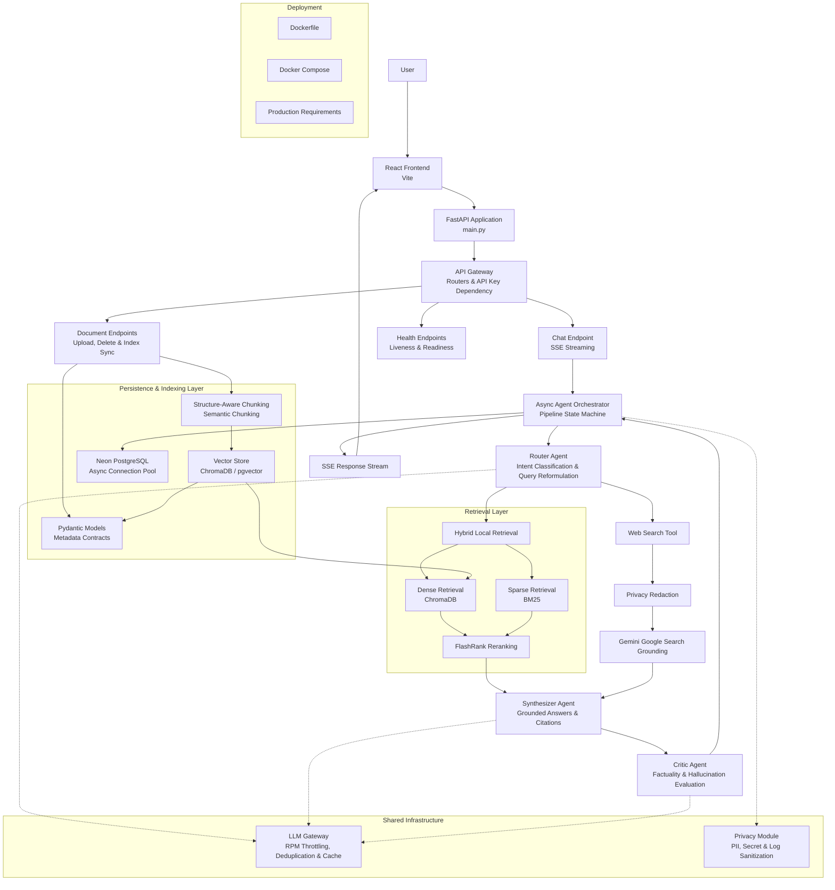
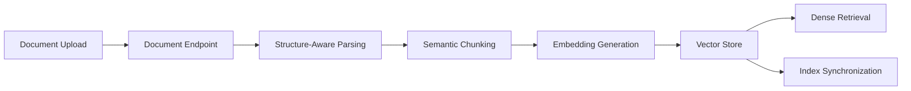

## 🏗️ System Architecture

This project follows a modular, multi-agent RAG architecture built with **FastAPI, React, ChromaDB, BM25, PostgreSQL, and Gemini**. It separates API handling, retrieval, agent orchestration, document indexing, persistence, and frontend responsibilities.

### 1. Architecture Overview



### 2. Project Directory Structure

```text
production/
│
├── app/
│   │
│   ├── main.py
│   │   # FastAPI entrypoint, application lifespan,
│   │   # CORS configuration and SSE streaming
│   │
│   ├── config.py
│   │   # Centralized configuration using Pydantic BaseSettings
│   │
│   ├── api/
│   │   └── v1/
│   │       │
│   │       ├── endpoints/
│   │       │   ├── chat.py
│   │       │   │   # SSE-based chat streaming endpoint
│   │       │   │
│   │       │   ├── documents.py
│   │       │   │   # Document upload, admin-gated deletion
│   │       │   │   # and index synchronization
│   │       │   │
│   │       │   └── health.py
│   │       │       # Container readiness and liveness probes
│   │       │
│   │       └── routers.py
│   │           # API route aggregation and API key dependency
│   │
│   ├── core/
│   │   │
│   │   ├── agents/
│   │   │   ├── router.py
│   │   │   │   # Intent classification and query reformulation
│   │   │   │
│   │   │   ├── synthesizer.py
│   │   │   │   # Grounded response generation and citation tracking
│   │   │   │
│   │   │   ├── critic.py
│   │   │   │   # Factuality evaluation and hallucination detection
│   │   │   │
│   │   │   └── orchestrator.py
│   │   │       # Async pipeline state machine and concurrent dispatcher
│   │   │
│   │   ├── tools/
│   │   │   ├── local_retriever.py
│   │   │   │   # Hybrid dense and sparse retrieval
│   │   │   │   # ChromaDB + BM25 + FlashRank
│   │   │   │
│   │   │   └── web_search.py
│   │   │       # Gemini Google Search Grounding
│   │   │       # with privacy redaction
│   │   │
│   │   ├── indexing/
│   │   │   └── chunkers.py
│   │   │       # Structure-aware document parsing
│   │   │       # and semantic chunking
│   │   │
│   │   ├── llm_gateway.py
│   │   │   # RPM throttling, single-flight deduplication
│   │   │   # and in-memory caching
│   │   │
│   │   └── privacy.py
│   │       # PII and secret redaction, log sanitization
│   │
│   └── db/
│       ├── models.py
│       │   # Pydantic schemas and metadata contracts
│       │
│       ├── postgres.py
│       │   # Neon PostgreSQL async connection pool
│       │   # for conversation turn history
│       │
│       └── vector_store.py
│           # Dense vector collection interface
│           # supporting ChromaDB / pgvector
│
├── frontend/
│   └── src/
│       # Vite + React real-time client
│       # SSE reader, dynamic citation badges
│       # and document manager
│
├── Dockerfile
│   # Production container image
│
├── docker-compose.yml
│   # Local multi-container orchestration
│
└── requirements.txt
    # Minimized production dependencies
```

### 3. Request Lifecycle

1. **User Query:** The React frontend sends a chat request to the FastAPI backend.
2. **API Gateway:** The request passes through API routing and API key validation.
3. **Agent Orchestration:** The orchestrator manages the asynchronous RAG pipeline.
4. **Query Routing:** The router agent classifies the user's intent and reformulates the query when required.
5. **Retrieval:** The system retrieves relevant context through hybrid local retrieval (ChromaDB + BM25 + FlashRank) and/or web search.
6. **Response Synthesis:** The synthesizer generates a grounded answer and tracks its citations.
7. **Response Evaluation:** The critic evaluates factuality and potential hallucinations.
8. **Streaming:** The orchestrator returns the response to the frontend through Server-Sent Events (SSE).

### 4. Document Indexing Lifecycle



### 5. Infrastructure and Supporting Components

| Component | Responsibility |
|---|---|
| FastAPI | REST API and SSE communication |
| React + Vite | Real-time frontend interface |
| ChromaDB | Dense vector storage and retrieval |
| BM25 | Sparse keyword-based retrieval |
| FlashRank | Retrieval result reranking |
| Gemini | LLM inference and Google Search Grounding |
| Neon PostgreSQL | Persistent conversation turn history |
| Pydantic | Configuration, validation and metadata schemas |
| Docker | Containerization and local orchestration |

